<div align="center">

# 💰 باقي | Baqy

**تطبيق أندرويد لتتبع المصاريف الشهرية، الميزانية، والأهداف المالية — بالعربي وبالصوت بالعامية المصرية.**

*An intuitive, privacy-first Android expense tracker with Egyptian-Arabic voice logging, local SQLite encryption, and smart monthly budgeting.*

<br/>

[](https://flutter.dev)
[](https://dart.dev)
[](https://blog.cleancoder.com/)
[](https://riverpod.dev)
[](https://drift.simonbinder.eu/)
[](https://android.com)

</div>

---

## 🌟 نبذة عن التطبيق

تطبيق **باقي** معمول عشان يجاوب على أهم سؤال بيشغل بالك طول الشهر: **"فاضلي كام الشهر ده؟"**

- 🎯 **ميزانية ذكية وحلقة تفاعلية:** بتحدد ميزانيتك الشهرية، وحلقة الشاشة الرئيسية بتعرضلك المتبقي ونسبة الصرف والتحويش لحظة بلحظة.
- 🎙️ **تسجيل المصاريف بالصوت (عامية مصرية):** بضغطة زرار على المايك اتكلم بطبيعتك (مثلاً: *"اتغديت بتمانين وركبت مواصلات بخمسة وعشرين"*) والذكاء الاصطناعي بيوزع المصاريف ويسجلها فوراً دون أي تعقيد.
- 🔒 **أمان وخصوصية 100%:** جميع بياناتك المالية بتتسجل محلياً على جهازك داخل قاعدة بيانات مشفرة بالكامل بـ **SQLCipher**، ومفتاح التشفير محفوظ داخل **Android Keystore**.
- 🏆 **أهداف مالية وتحويش:** خطط لأهدافك وحوش فيها أو اسحب منها بسهولة مع حساب فوري للمتبقي ومعدل التوفير.
- ⏰ **مواعيد واشتراكات:** مواعيد دورية أو لمرة واحدة مع إشعارات تذكير ذكية على جهازك قبل موعد الاستحقاق.
- 🤝 **سجل الديون:** إدارة كاملة للديون (عليا / ليا) ومتابعة دفعات السداد الجزئي والكامل وأرشيف الديون المسددة.

---

## 📱 معرض شاشات التطبيق (Screenshots)

### ١. الواجهة الرئيسية والميزانية الذكية (Light & Dark Theme)
<table align="center">
  <tr>
    <td align="center"><b>الرئيسية وحلقة الميزانية (الوضع الفاتح)</b></td>
    <td align="center"><b>الرئيسية (الوضع الليلي الأنيق)</b></td>
  </tr>
  <tr>
    <td>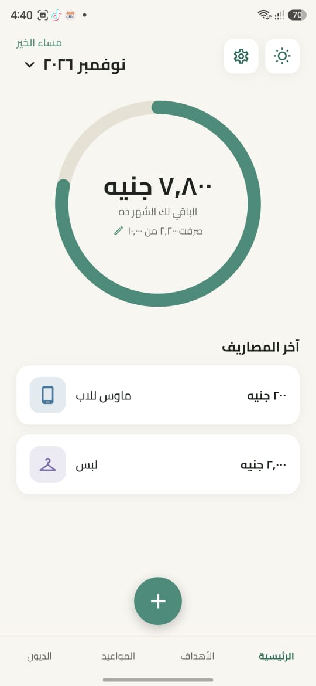</td>
    <td>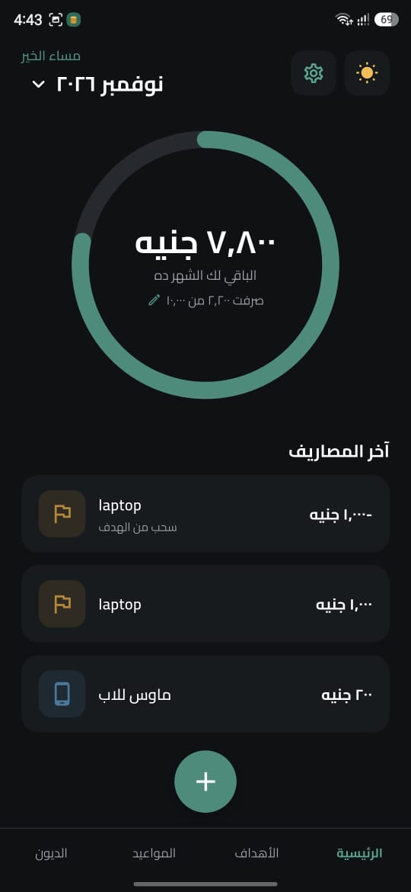</td>
  </tr>
</table>

<br/>

### ٢. تفاصيل وتحليلات مصاريف الشهر
<table align="center">
  <tr>
    <td align="center"><b>تفاصيل مصاريف الشهر والتصنيفات</b></td>
    <td align="center"><b>تسجيل مصروف فوري وسريع</b></td>
  </tr>
  <tr>
    <td>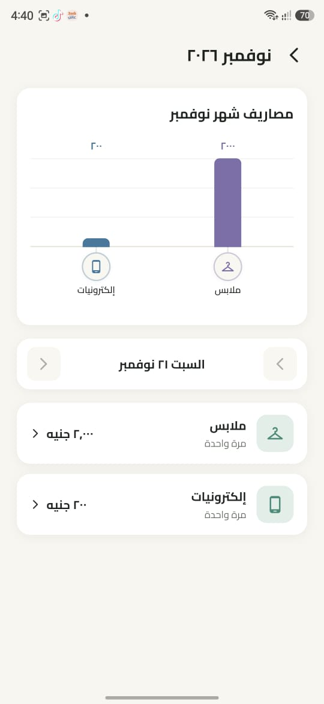</td>
    <td>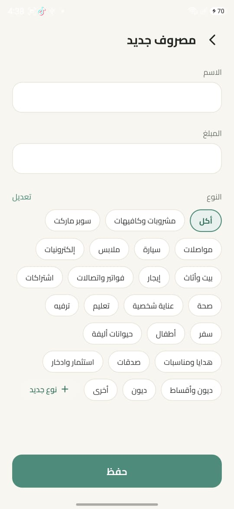</td>
  </tr>
</table>

<br/>

### ٣. الأهداف المالية والادخار (Goals)
<table align="center">
  <tr>
    <td align="center"><b>قائمة الأهداف ونسب الإنجاز</b></td>
    <td align="center"><b>تفاصيل الهدف وحركات التحويش والسحب</b></td>
  </tr>
  <tr>
    <td>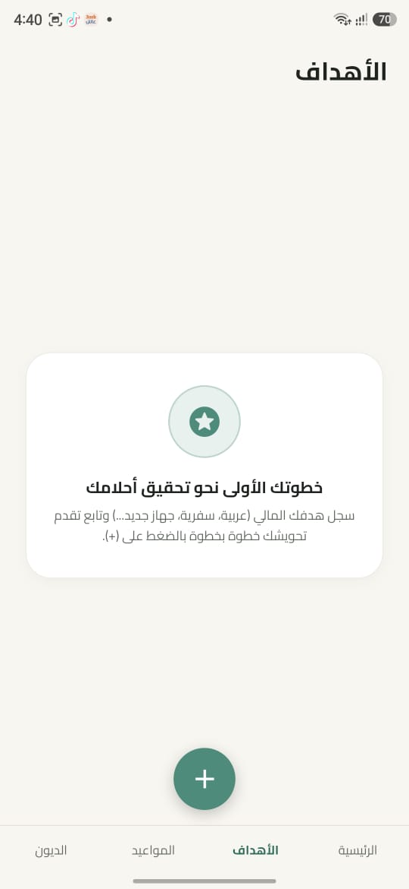</td>
    <td>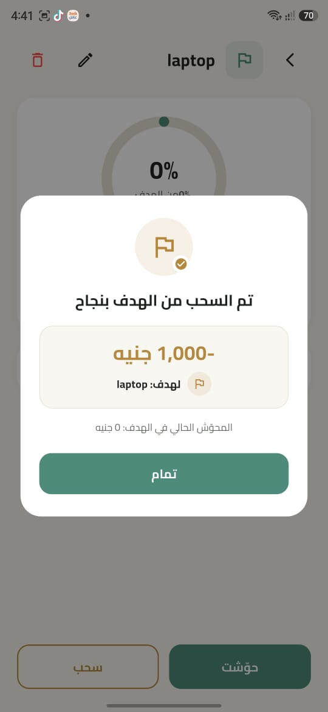</td>
  </tr>
</table>

<br/>

### ٤. المواعيد والإشعارات المجدولة (Reminders)
<table align="center">
  <tr>
    <td align="center"><b>جدول المواعيد والاشتراكات الدورية</b></td>
    <td align="center"><b>إشعار التذكير المحلي الذكي</b></td>
  </tr>
  <tr>
    <td>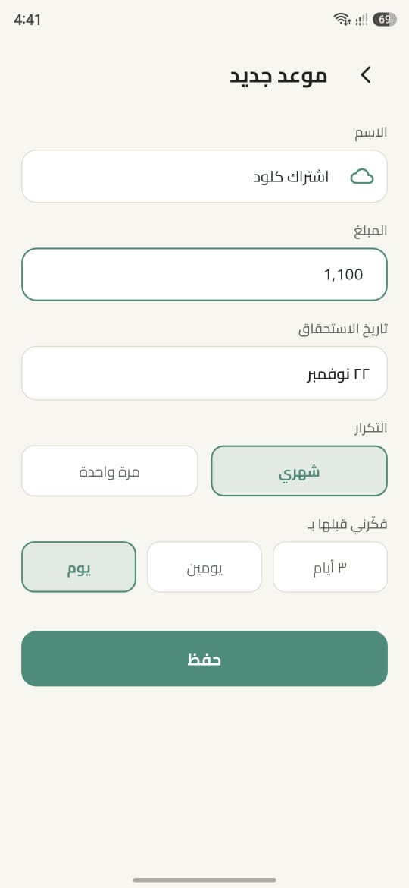</td>
    <td>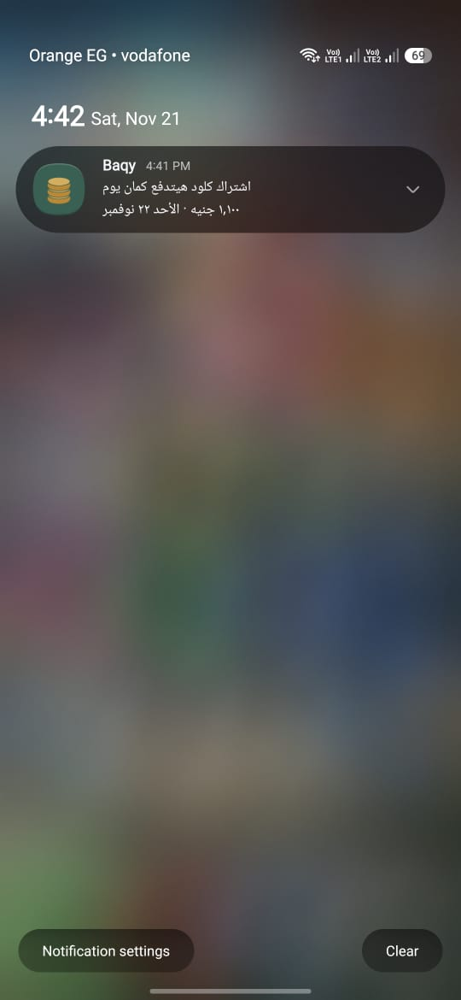</td>
  </tr>
</table>

<br/>

### ٥. سجل الديون والإعدادات العامة (Debts & Settings)
<table align="center">
  <tr>
    <td align="center"><b>سجل الديون (عليا / ليا)</b></td>
    <td align="center"><b>شاشة الإعدادات، الثيم، والعملة</b></td>
  </tr>
  <tr>
    <td>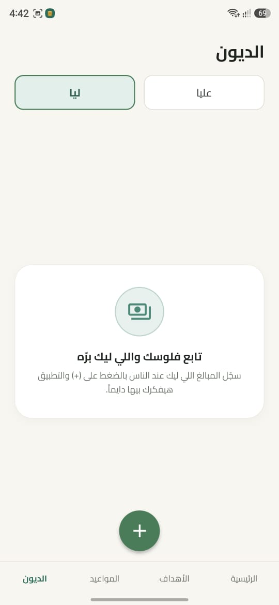</td>
    <td>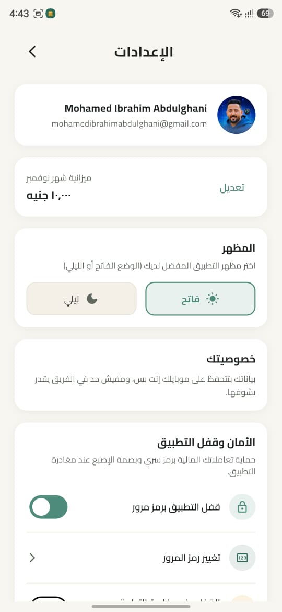</td>
  </tr>
</table>

<br/>

### ٦. البداية والولوج الآمن (Onboarding & Auth)
<table align="center">
  <tr>
    <td align="center"><b>شاشة البداية (Splash)</b></td>
    <td align="center"><b>تسجيل الدخول الآمن (Google Sign-In)</b></td>
  </tr>
  <tr>
    <td>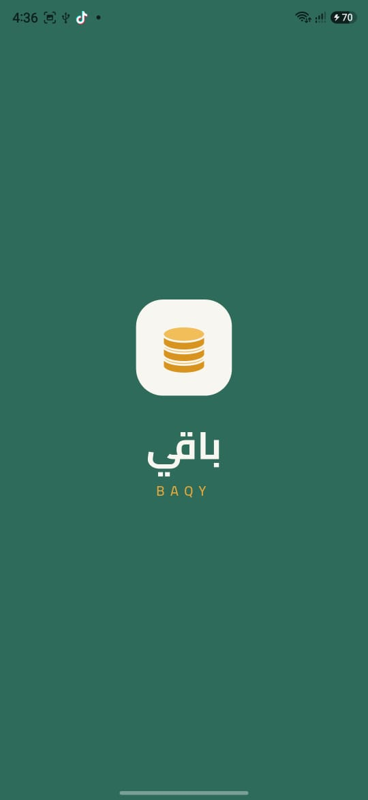</td>
    <td>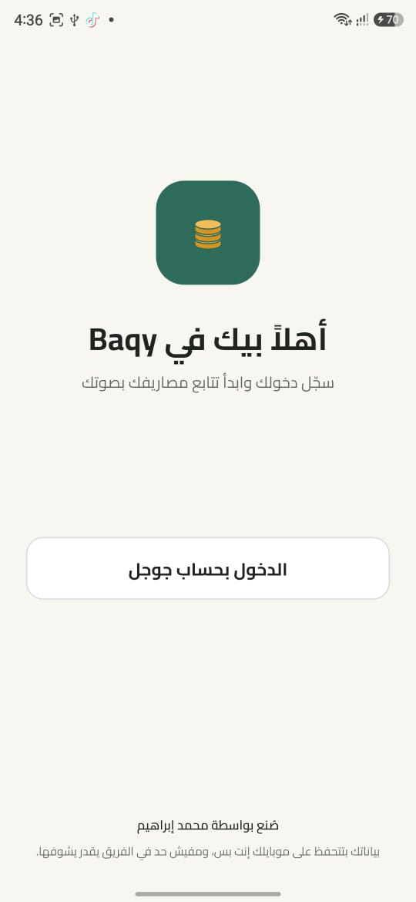</td>
  </tr>
</table>

---

## 🛠️ التقنيات المستخدمة (Tech Stack)

| الغرض / الميزة | التقنية / المكتبة | الوصف |
|---|---|---|
| **الإطار الأساسي** | `Flutter` & `Dart` | بناء التطبيق بأداء عالي وتجربة Native سلسة |
| **المعمارية** | `Clean Architecture` | تقسيم المشروع لـ Presentation, Domain, Data مع Feature-First |
| **إدارة الحالة** | `Riverpod` (`flutter_riverpod`) | إدارة تدفق البيانات وتحديث الواجهات بكفاءة واختبارية عالية |
| **قاعدة البيانات** | `Drift` + `SQLCipher` | قاعدة بيانات محلية Relational فائقة السرعة مع تشفير كامل 256-bit |
| **تخزين المفاتيح** | `flutter_secure_storage` | حفظ مفتاح التشفير داخل بيئة Android Keystore المشفرة |
| **التنقل والروابط** | `go_router` | نظام توجيه مسارات مركزي وDeclartive Routing |
| **فهم الصوت والذكاء الاصطناعي** | `speech_to_text` + Gemini AI & Pure Dart Regex Engine | التعرف على الصوت وتحليل اللهجة العامية المصرية مع Fallback محلي كامل |
| **الإشعارات المجدولة** | `flutter_local_notifications` + `timezone` | جدولة التنبيهات المحلية بدقة حسب التوقيت المحلي (Africa/Cairo) |
| **الهوية والمصادقة** | `Firebase Auth` + `Google Sign In` | تسجيل دخول آمن بالهوية فقط دون رفع أي بيانات مالية |
| **الخط والتصميم** | خط `Cairo` وتنسيق RTL أصيل | خط عربي أنيق مدمج مع دعم كامل للأرقام العربية المشرقية والإنجليزية |

---

## 🏗️ هيكل المشروع (Project Structure)

تم بناء المشروع باتباع مبادئ **Clean Architecture** و**Feature-First Pattern**:

```text
lib/
├── core/
│   ├── constants/        # ألوان التطبيق، الثوابت، وأيقونات النظام
│   ├── database/         # إعداد Drift وSQLCipher وإدارة اتصالات الحسابات
│   ├── errors/           # كلاسات الفشل والأخطاء الموحدة (Failures)
│   ├── network/          # عميل الشبكة والمزامنة
│   ├── routing/          # تعريف المسارات عبر GoRouter
│   ├── services/         # خدمات الإشعارات، الصوت، والنسخ الاحتياطي
│   ├── theme/            # ثيم التطبيق والألوان (Light & Dark)
│   ├── utils/            # منسق الأرقام، مساعد الأيقونات، والتاريخ
│   └── widgets/          # عناصر الواجهة المشتركة والقابلة لإعادة الاستخدام
│
├── features/
│   ├── auth/             # تسجيل الدخول بجوجل وإدارة حالة الحساب
│   ├── debts/            # إدارة الديون وسجل الدفعات
│   ├── expenses/         # إضافة المصروف، التصنيفات، ومحلل الصوت المصري
│   ├── goals/            # الأهداف المالية، التحويش، والسحب
│   ├── home/             # الشاشة الرئيسية، حلقة الميزانية، وتصفح الشهور
│   ├── month_details/    # تحليلات الشهر، الرسم البياني، ومصاريف الأيام
│   ├── reminders/        # المواعيد، الاشتراكات، وجدولة الإشعارات
│   ├── security/         # فحص أمان الجهاز وحماية الجلسة
│   ├── settings/         # الإعدادات، الثيم، ومسح وتصدير البيانات
│   ├── shell/            # الإطار الخارجي وشريط التنقل السفلي
│   └── splash/           # شاشة البداية وفحص التوجيه الأولي
│
└── main.dart             # نقطة انطلاق التطبيق وتهيئة الخدمات
```

---

## 🔐 الأمان والخصوصية (Privacy & Security)

- 🔒 **تشفير كامل للبيانات:** قاعدة البيانات مشفرة باستخدام معيار AES-256 عبر SQLCipher.
- 🔑 **مفاتيح التشفير:** يتم توليد مفتاح عشوائي فريد لكل جهاز، ويُخزن في Android Keystore الآمن، ولا يمكن استخراجه أو الوصول إليه خارج التطبيق.
- 🛡️ **Offline-First:** جميع معاملاتك المالية وحساباتك وأهدافك لا تغادر هاتفك إطلاقاً، وتظل ملكاً لك وحدك.
- 👤 **تسجيل الدخول:** يتم استخدام Google Auth فقط لتأكيد الهوية وعزل قاعدة بيانات كل حساب على الجهاز.

---

## 🚀 طريقة تشغيل المشروع محلياً (Getting Started)

### المتطلبات الأساسية
- مثبت **Flutter SDK** (الإصدار 3.24+ أو أحدث).
- بيئة **Android Studio** مع Android SDK وJava 17.
- هاتف أندرويد حقيقي أو محاكي (Android Emulator).

### خطوات التثبيت والتشغيل

1. **استنساخ المستودع (Clone Repository):**
   ```bash
   git clone https://github.com/your-username/Baqy.git
   cd Baqy
   ```

2. **تثبيت الحزم والاعتماديات:**
   ```bash
   flutter pub get
   ```

3. **توليد ملفات الكود المساعد (Drift & Code Generation):**
   ```bash
   dart run build_runner build --delete-conflicting-outputs
   ```

4. **تشغيل الفحص الآلي للاختبارات:**
   ```bash
   flutter test
   ```

5. **تشغيل التطبيق على الهاتف / المحاكي:**
   ```bash
   flutter run
   ```

---

## 👨‍💻 المطور (Author)

**محمد إبراهيم (Mohamed Ibrahim)**
- تخصص: تطوير تطبيقات الهاتف المحمول باستخدام Flutter.
- رؤية المشروع: تقديم حل مالي عربي بسيط، أنيق، وسريع يعتمد على الخصوصية والذكاء وسهولة الاستخدام اليومي.
