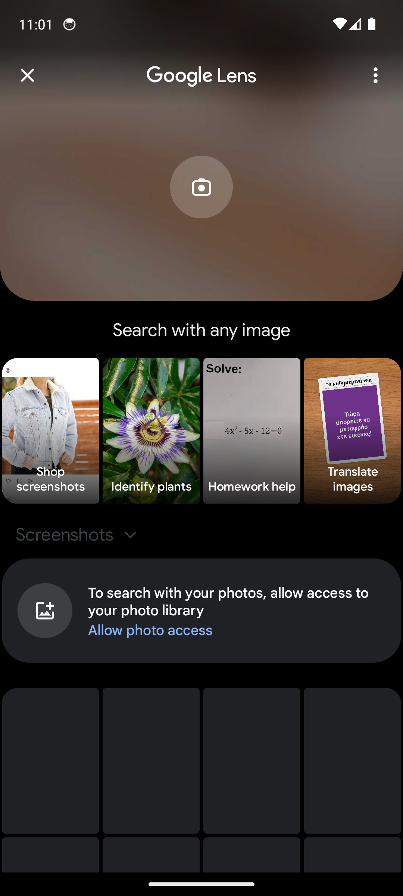
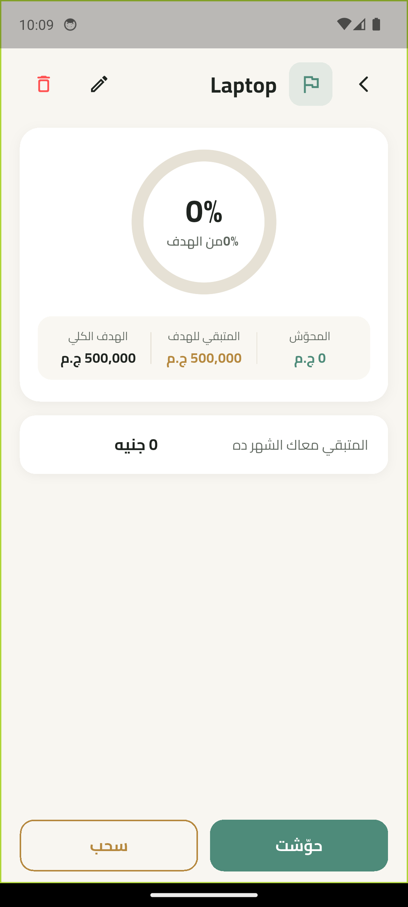
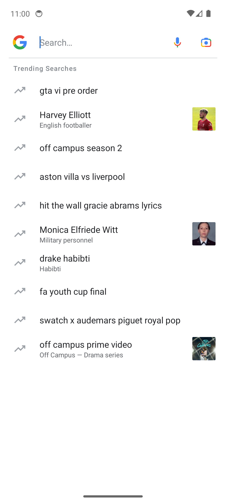
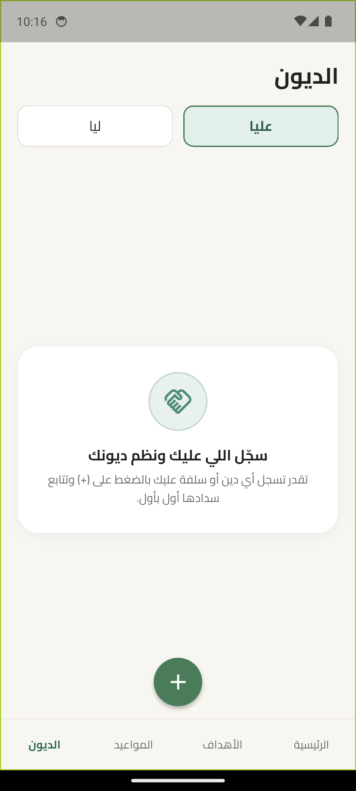
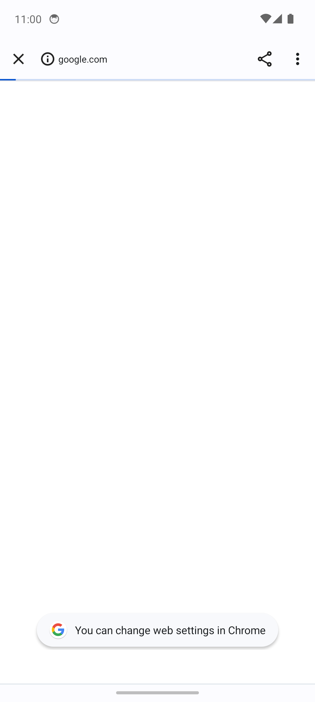

<div align="center">

# 💰 باقي | Baqy

**تطبيق أندرويد لتتبع المصاريف الشهرية، الميزانية، والأهداف المالية — بالعربي وبالصوت بالعامية المصرية.**

*An intuitive, privacy-first Android expense tracker with Egyptian-Arabic voice logging, local SQLite encryption, and smart monthly budgeting.*

<br/>

[](https://flutter.dev)
[](https://dart.dev)
[](https://blog.cleancoder.com/)
[](https://riverpod.dev)
[](https://drift.simonbinder.eu/)
[](https://android.com)

</div>

---

## 💡 فكرة المشروع

تطبيق **باقي** معمول عشان يجاوب على أهم سؤال بيشغل بالك طول الشهر:

> **"فاضلي كام الشهر ده؟"**

بتحدد ميزانيتك، وتسجل مصاريفك بالكتابة أو بالصوت بالعامية المصرية، والتطبيق بيحسبلك المتبقي ونسبة الصرف لحظة بلحظة — من غير تعقيد، ومن غير ما بياناتك تسيب موبايلك.

### إزاي بيشتغل؟

1. **حدد ميزانية الشهر** — حلقة الشاشة الرئيسية بتوريك الباقي أول بأول.
2. **سجل مصروفك** — اضغط على المايك وقول: *"اتغديت بتمانين وركبت مواصلات بخمسة وعشرين"* والتطبيق يوزعها ويسجلها لوحده.
3. **تابع وحلل** — شوف مصاريف الشهر حسب اليوم والتصنيف.
4. **نظّم التزاماتك** — أهداف تحويش، مواعيد واشتراكات، وسجل ديون.

---

## 📱 لقطات من التطبيق

<table align="center">
  <tr>
    <td align="center"><b>الرئيسية وحلقة الميزانية</b></td>
    <td align="center"><b>التسجيل بالصوت</b></td>
    <td align="center"><b>الحفظ التلقائي</b></td>
    <td align="center"><b>تفاصيل الشهر</b></td>
  </tr>
  <tr>
    <td></td>
    <td></td>
    <td></td>
    <td></td>
  </tr>
  <tr>
    <td align="center"><b>الأهداف والتحويش</b></td>
    <td align="center"><b>المواعيد والاشتراكات</b></td>
    <td align="center"><b>سجل الديون</b></td>
    <td align="center"><b>الوضع الليلي</b></td>
  </tr>
  <tr>
    <td></td>
    <td></td>
    <td></td>
    <td></td>
  </tr>
</table>

---

## 🌟 أهم المميزات

- 🎯 **ميزانية ذكية:** حلقة تفاعلية بتعرض المتبقي ونسبة الصرف.
- 🎙️ **تسجيل بالصوت بالعامية المصرية:** Gemini AI مع محلل Regex محلي كـ Fallback.
- 🏆 **أهداف مالية:** حوّش أو اسحب مع حساب فوري للمتبقي.
- ⏰ **مواعيد واشتراكات:** إشعارات تذكير قبل موعد الاستحقاق.
- 🤝 **سجل الديون (عليا / ليا):** دفعات سداد جزئي وكامل وأرشيف للمسدد.
- 🌗 **ثيم فاتح وداكن** بخط Cairo وتنسيق RTL كامل.

---

## 🔐 الأمان والخصوصية

- 🔒 قاعدة البيانات مشفرة بـ **AES-256** عبر SQLCipher.
- 🔑 مفتاح التشفير فريد لكل جهاز ومحفوظ في **Android Keystore**.
- 🛡️ **Offline-First:** بياناتك المالية لا تغادر هاتفك.
- 👤 Google Sign-In لتأكيد الهوية فقط، من غير رفع أي بيانات مالية.

---

## 🛠️ التقنيات المستخدمة

| الغرض | التقنية |
|---|---|
| الإطار الأساسي | `Flutter` & `Dart` |
| المعمارية | `Clean Architecture` (Feature-First) |
| إدارة الحالة | `Riverpod` |
| قاعدة البيانات | `Drift` + `SQLCipher` |
| تخزين المفاتيح | `flutter_secure_storage` |
| التنقل | `go_router` |
| الصوت والذكاء الاصطناعي | `speech_to_text` + Gemini AI + Regex Engine |
| الإشعارات | `flutter_local_notifications` + `timezone` |
| المصادقة | `Firebase Auth` + `Google Sign In` |

---

## 🚀 التشغيل محلياً

```bash
git clone https://github.com/MohamedIbrahimAbdulghani/Baqy.git
cd Baqy
flutter pub get
dart run build_runner build --delete-conflicting-outputs
flutter run
```

**المتطلبات:** Flutter 3.24+، Android Studio مع Android SDK وJava 17، وهاتف أو محاكي أندرويد.

---

## 👨‍💻 المطور

**محمد إبراهيم (Mohamed Ibrahim)** — مطور تطبيقات موبايل بـ Flutter.

رؤية المشروع: حل مالي عربي بسيط وأنيق وسريع، يعتمد على الخصوصية وسهولة الاستخدام اليومي.
